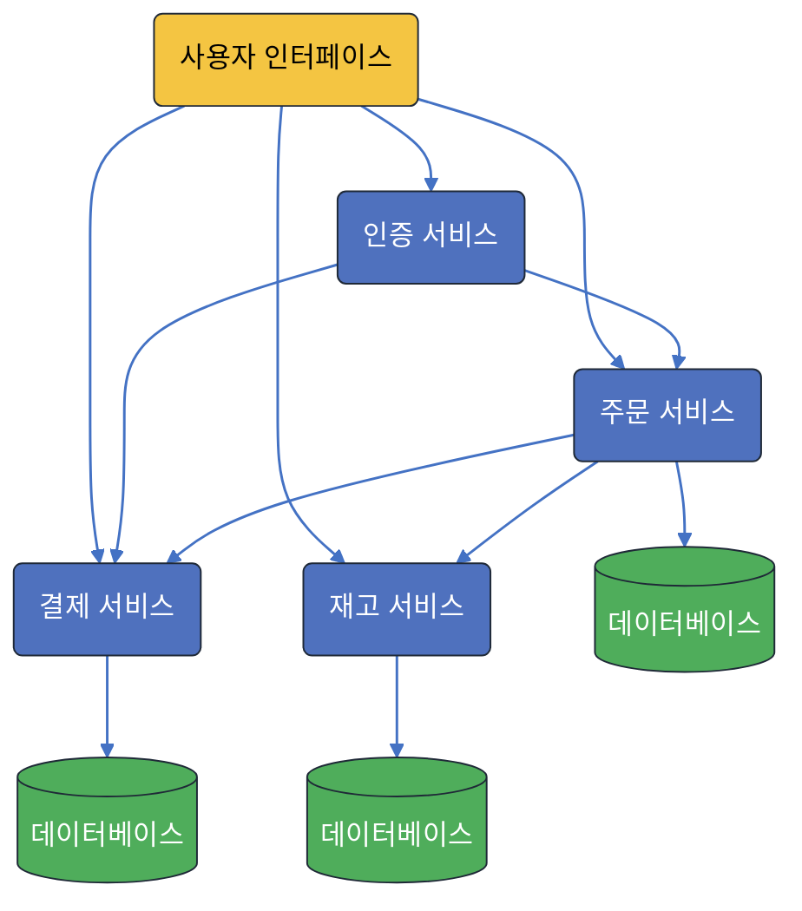

# 블로그 그림 스타일 (구조도·아키텍처)

블로그 글에 구조도를 그릴 때 따르는 기준. 학습자가 2026-11-24에 참고 그림으로 준 아키텍처 다이어그램
(사용자 인터페이스 → 인증/결제/주문/재고 서비스 → 각자의 데이터베이스)을 바탕으로 정리했다.

## 원칙
- **위 → 아래로 층을 나눈다**: 진입점(사용자·입력) → 처리(서비스·로직) → 저장(DB·메모리)
- **역할마다 색 하나**: 같은 층의 박스는 같은 색. 색은 3가지를 넘기지 않는다
- **모양으로 종류 구분**: 처리 = 둥근 사각형, 저장소 = 원통
- **화살표는 얇은 파란 선 한 가지**, 방향 = 호출·데이터 흐름. 같은 층끼리의 호출은 가로 화살표
- 박스 안 글자는 짧은 명사구 하나 (설명은 본문에서)

## 색
| 층 | 모양 | 채움 | 테두리 | 글자 |
|---|---|---|---|---|
| 진입점 (UI·사용자·입력) | 둥근 사각형 | `#F4C542` 노랑 | `#1F2937` | 검정 |
| 처리 (서비스·모듈·CPU 등) | 둥근 사각형 | `#4F71BE` 파랑 | `#1F2937` | 흰색 |
| 저장 (DB·RAM·디스크 등) | 원통 | `#4FAD5B` 초록 | `#1F2937` | 흰색 |
| 화살표 | — | — | `#4472C4` 1.5px | — |

## Mermaid 템플릿 (참고 그림 재현)
front matter에 `mermaid: true` 필요.

## 자바 스터디 글에 적용하는 예
같은 3색 규칙을 강의 개념에 그대로 쓴다.
- 1.3 컴퓨터 구조: SSD/RAM = `store`(원통), CPU·캐시 = `svc`, OS 적재 화살표
- 1.2 PATH 검색 흐름: `javac` 입력 = `entry`, 검색 단계 = `svc`, 판단은 마름모 `{}` (색 없음)
- 이후 JVM 런타임 데이터 영역(Part2 6.5): 클래스 로더 = `svc`, 메서드·힙·스택 영역 = `store`

## 주의
- Chirpy 다크 모드에서도 읽히도록 글자색을 `color:`로 명시한다
- 노드가 8개를 넘으면 그림을 나눈다
- 선이 많이 교차하면 노드 선언 순서를 바꿔 정리한다 (Mermaid는 선언 순서대로 배치)

## SW·HW 두 층 (2026-11-26 추가)
- 구조도는 SW 층과 HW 층을 `subgraph`로 나눠 둘 다 그린다. 설명 순서·템플릿은 `10_설명구조.md`.
- 두 층을 잇는 화살표에는 라벨을 단다.
