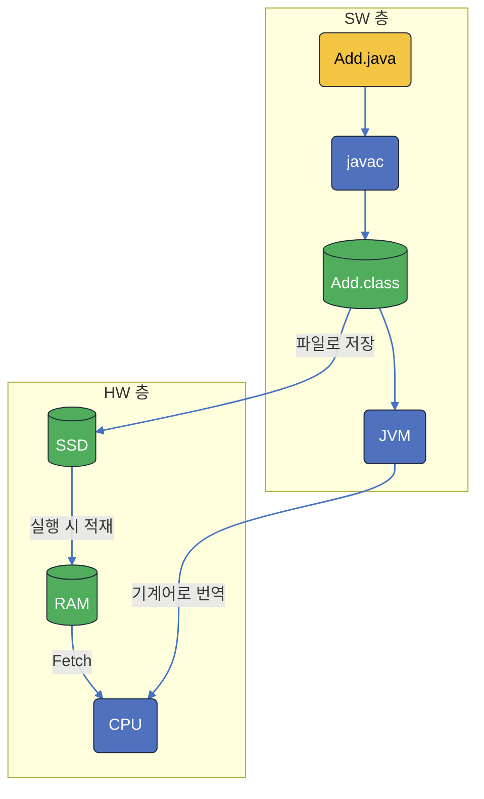

# 설명 구조 — 항상 SW와 HW를 함께 그린다

학습자 지시(2026-11-26): "시각화는 언제나 SW, HW 모두 보여줘." 널널한 개발자 강의의 설명 방식을 이 저장소의 노트·질문·시험 해설에 맞게 정리한 틀이다.
출처: 강의 영상이 아니라 notes/Part1-1~3장(1.3 컴퓨터 구조, 1.4 연산, 3.1 JVM)에 이미 정리된 설명 흐름. 영상 내용을 옮겨 적은 것은 아니다.
색·모양은 `09_블로그그림스타일.md`를 그대로 쓴다. 이 문서는 "무엇을 그리나"를 정하고, 09는 "어떻게 칠하나"를 정한다.

## 1. 설명 순서 (한 개념 = 한 줄 코드에서 부품까지 내려갔다 올라오기)
1. **한 줄**: 코드 한 줄 또는 현상 하나 (예: `int c = a + b;`, `javac Add.java`)
2. **SW 층**: 사람이 쓴 말 → 번역 단계 → 실행기. (고급어 → 바이트코드 → JVM → 기계어)
3. **HW 층**: 그 단계가 실제로 쓰는 부품. (SSD → RAM → 캐시 → CPU의 Fetch·Decode·Execute)
4. **짝짓기**: SW의 어느 단계가 HW의 어느 부품에서 일어나는가를 화살표 라벨로 적는다.
5. **대가·한계**: 이 구조 때문에 생기는 비용 (시작 속도, 메모리 사용, 이식성 등)

## 2. 그림 규칙
- 구조도는 **SW 층(위)과 HW 층(아래) 두 덩어리**로 나눈다. 칸 = 층, 색 = 09의 역할 색(입력 노랑 · 처리 파랑 · 저장 초록).
- 두 층을 잇는 화살표에는 **라벨**을 붙인다 ("적재", "Fetch", "기계어로 번역" 등).
- 한 그림 노드 8개 이하. 넘으면 SW 그림 / HW 그림 / 둘을 잇는 그림으로 나눈다.
- 박스 글자는 짧은 명사구. 설명은 그림 밖 본문에.
- 실제로 일어나는 일만 그린다. 추정이거나 단순화한 부분은 "단순화"라고 적는다.
- 개념이 HW와 직접 닿지 않는 회차(로드맵·취업·글쓰기 등)는 HW 층에 억지로 칸을 만들지 않고 "HW 해당 없음" 한 줄만 적는다. 그 외에는 생략하지 않는다.

## 3. 템플릿 (Java 한 줄이 실행되기까지)


## 4. 확인 질문 틀
그림을 그린 뒤 질문 1개는 **짝짓기형**으로 낸다: "이 단계는 SW의 무엇이고 HW의 어디에서 일어나나?" (예: `iadd` 명령이 실행될 때 RAM과 CPU 중 누가 무엇을 하나)

## 5. 세션에 붙이는 한 줄 (압축 프롬프트용)
```
구조도는 항상 SW 층(코드→번역→실행기)과 HW 층(SSD·RAM·캐시·CPU)을 둘 다 그리고, 두 층을 잇는 화살표에 라벨을 단다. 규칙=claude/10_설명구조.md, 색=09.
```
