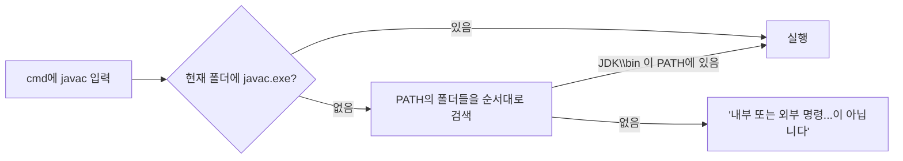
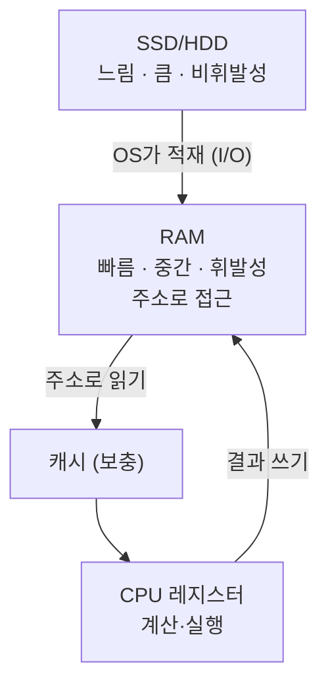
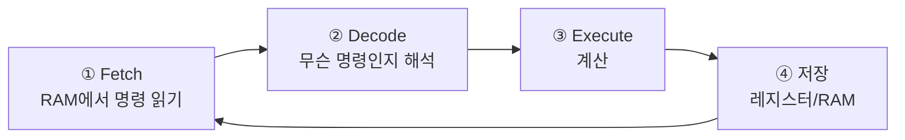

# Part1 1장 강의 노트

> 「독하게 시작하는 Java」(널널한 개발자 TV) Part1 1장. 영상 내용이 아니라 학습자 요약·메모와 튜터 정리를 바탕으로 작성. 영상 밖 내용은 **보충**으로 표시.

---

## 1.1 학습준비에 대해 가정하는 것들
- 강의일 2026-11-23 · 주제 기준 강의(영상 먼저 방식 도입 전) · 이해도 4(튜터)

### 핵심 개념
1. **강의가 전제하는 출발선**: 프로그램 설치·실행, 파일/폴더·경로, 확장자, 타자
2. **사용자 관점 vs 개발자 관점**: "실행된다"에서 멈추나, "무슨 일이 일어나서 실행되나"를 궁금해하나
3. **스스로 해결하는 능력**: 오류 메시지는 실패가 아니라 단서 (비유: 계기판 경고등)
4. **학습 목표**: 문법 암기가 아니라 "왜 이렇게 동작하는지" 설명하기

### 오류를 만났을 때 개발자의 순서
```
오류 메시지 읽기 (종류 · 위치(파일/줄) · 원인)  →  그 위치로 이동  →  코드 확인
```

### 확인 질문
- Q. 빨간 오류에 대한 사용자/개발자 반응 비교 → ✅ 정답 (보완: 코드로 가기 전에 메시지를 먼저 읽는다)

---

## 1.2 Windows OS 사용에 관한 정리 (19:29)
- 강의일 2026-11-23 · 영상 시청 · 이해도 3(튜터)
- 한 줄 요약(다듬은 것): Java는 OS 위에서 파일을 읽고 실행되는 프로그램이므로, 파일 시스템·경로·실행 파일 같은 OS 기본을 알아야 Java의 동작이 보인다.

### 핵심 개념
1. **절대 경로 / 상대 경로**
   - 절대: `C:\study\java\test.txt` (루트부터 전체)
   - 상대: 현재 작업 폴더 기준. `.` = 현재, `..` = 상위 → `./test.txt`, `../testup.txt`
   - 상대 경로는 "어디서 실행하느냐"에 따라 결과가 달라짐
2. **파일 = 이름 + 확장자**: OS는 확장자로 열 프로그램을 정함. 숨기면 `사진.jpg.exe` 위장 위험. Java는 `Hello.java` / `Hello.class`처럼 확장자만 다른 파일을 계속 다룸
3. **cmd 명령**
   | 명령 | 뜻 |
   |---|---|
   | `cd 경로` | 폴더 이동 (인자 없이 `cd` → 현재 경로 출력) |
   | `dir` | 현재 폴더 안의 **파일·폴더 목록** |
   | `echo %PATH%` | PATH 값 출력 |
   | `where java` | PATH에서 java.exe 위치 찾기 |
4. **PATH 환경 변수** ⚠️ = 명령을 입력했을 때 OS가 **실행 파일을 찾으러 가는 폴더 목록** (명령어 목록 아님). 비유: 물건 찾을 때 뒤져 볼 서랍 목록
5. **보충**: 바이트 스트림(파일 = 바이트의 나열, 그것을 흘려 읽고 쓰는 통로), `.exe`(OS·CPU가 직접 실행) vs `.class`(JVM이 실행), 스레드(Part3 2.1)



### 예제
```java
import java.nio.file.*;
public class PathDemo {
    public static void main(String[] args) {
        System.out.println("현재 작업 폴더: " + Paths.get("").toAbsolutePath());
        System.out.println("./test.txt    → " + Paths.get("./test.txt").toAbsolutePath().normalize());
        System.out.println("../testup.txt → " + Paths.get("../testup.txt").toAbsolutePath().normalize());
    }
}
```

### 확인 질문
- Q. JDK를 설치했는데 `javac`가 "명령이 아닙니다"라고 나옴 → ✅ 정답(보완). 등록하는 건 명령어가 아니라 **`javac.exe`가 있는 JDK `bin` 폴더**. `where javac`로 확인 → PATH에 추가 → **cmd를 새로 열어** 재확인

---

## 1.3 컴퓨터 구조에 대한 상식 (12:03)
- 강의일 2026-11-23 · 영상 시청 · 이해도 5(튜터)
- 한 줄 요약: 데이터가 어디에 저장되고 어떻게 접근·참조되는지(CPU·RAM 구조)를 알아야, 나중에 JVM의 메모리 구조를 이해하고 다룰 수 있다.

### 핵심 개념
1. **CPU · RAM · 저장 장치**
   | 장치 | 역할 | 속도 | 용량 | 전원 OFF |
   |---|---|---|---|---|
   | CPU | 계산·실행 | 가장 빠름 | 매우 작음 | 사라짐 |
   | RAM | 실행 중인 코드·데이터를 올려 두는 작업대 | 빠름 | GB | 사라짐(휘발성) |
   | SSD/HDD | 장기 보관 | 느림 | TB | 남음(비휘발성) |
   - 비유: CPU = 요리사, RAM = 조리대, SSD = 창고
2. **실행 흐름**: SSD → (OS가 적재) → RAM → (CPU가 주소로 접근) → CPU → 결과를 RAM에 씀. RAM에 올라가 실행 중인 프로그램 = 프로세스
3. **접근과 참조**: RAM은 주소가 붙은 칸들. 접근 = 주소로 찾아가 읽고 쓰기, 참조 = 값이 있는 위치를 가리키기
4. **왜 알아야 하나**: JVM은 컴퓨터 구조를 흉내 낸 가상 컴퓨터 → Part2 6.5 런타임 데이터 영역, Part3 4.3~4.6 캐시·volatile로 이어짐
5. **보충**: 캐시(레지스터 > 캐시 > RAM > SSD), 1바이트 = 8비트, RAM 주소는 바이트 단위, 64비트 CPU



### 예제 (보충: 참조 미리보기)
```java
int a = 10; int b = a; b = 20;        // a는 10 그대로 (값 복사)
int[] x = {10}; int[] y = x; y[0] = 20; // x[0]도 20 (위치 공유)
```

### 확인 질문
- Q. CPU는 왜 SSD에서 바로 읽지 않고 RAM을 거치나 → ✅ 정답
  - 정리: RAM을 거치는 이유 = **속도**. SSD가 필요한 이유 = **용량 + 비휘발성**
  - **보충**: CPU는 RAM 주소에만 직접 접근 가능. SSD 데이터는 OS가 I/O로 RAM에 올려 줘야 함

---

## 1.4 실행의 다른 이름 연산 ★ (9:56)
- 강의일 2026-11-23 · **영상 미시청**(주제 기준 강의) · 이해도 4(튜터)

### 핵심 개념
1. **실행 = 연산의 반복**: Fetch → Decode → Execute → 저장 → 반복
2. **연산자 / 피연산자**: `a + b` → `+` 연산자, `a`·`b` 피연산자. 단항·이항·삼항 (3.3 항·식·구문으로 연결)
3. **연산 종류**
   | 종류 | 연산자 | 결과 |
   |---|---|---|
   | 산술 | `+ - * / %` | 숫자 |
   | 비교 | `== != > < >= <=` | true/false |
   | 논리 | `&&` `\|\|` `!` | true/false |
   | 대입 | `= += -=` | 변수에 저장 |
4. **결과는 값 → 메모리에 저장**: `x = x + 1`은 오른쪽 계산 후 x에 다시 저장
5. **자료형에 따라 결과가 다름**: `10 / 3` → 3, `10.0 / 3` → 3.333… (하나라도 실수면 실수 연산)



### 확인 질문
- Q. `a=9, b=4` → `a/b`, `a%b`, `a/b*b + a%b`, `a > b && a % 2 == 0` 예측 → **3/4**
  - ①2 ②1 ③9 ✅ / ④ true라고 답함 ❌ → 정답 **false**
  - `9 % 2 == 0` → `1 == 0` → false → `true && false` → false
  - `% 2 == 0` = 짝수 판별. `&&`는 양쪽 모두 true여야 true
  - **보충**: 단락 평가 (`&&`는 왼쪽이 false면 오른쪽을 계산하지 않음)
