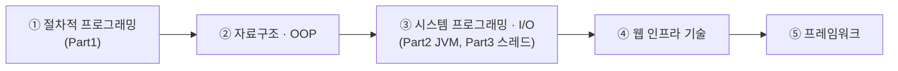
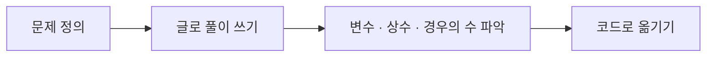
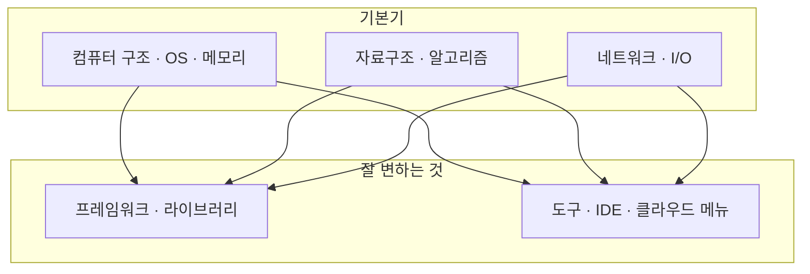

# Part1 2장 강의 노트

> 「독하게 시작하는 Java」(널널한 개발자 TV) Part1 2장. 학습자 요약·메모와 튜터 정리를 바탕으로 작성. 영상 밖 내용은 **보충**으로 표시.

---

## 2.1 제대로 달리는 학습순서 (9:27)
- 강의일 2026-11-23 · 영상 시청 · 이해도 4(튜터)
- 한 줄 요약: 절차적 프로그래밍의 중요성과, 이 강의가 전체 학습 로드맵의 어디를 다루는지 설명한다.

### 핵심 개념
1. **학습 로드맵 5단계**: 절차적 프로그래밍 → 자료구조·OOP → 시스템 프로그래밍·I/O → 웹 인프라 기술 → 프레임워크
   - Part1 = ① 절차적 프로그래밍
   - **보충**: 각 단계가 앞 단계를 재료로 쓰므로 순서가 중요 (비유: 1층 없이 5층을 올릴 수 없음)
2. **문제를 만나면 먼저 파악할 것**: 변수(바뀌는 것) / 상수(고정된 것) / 경우의 수(상황별 분기) → 4.2, 4.3
3. **피해야 할 공부법 = 따라 치기**: "틀린 그림 찾기"에 그침. 문제 정의 → 글로 쓰기 → 코드 순서로 (4.1 사실은 글쓰기)





### 예제: 글로 쓰고 코드로 옮기기 (짝수 판별)
```java
int n = 9;                  // 변수
if (n % 2 == 0) System.out.println(n + "은(는) 짝수");   // 경우 1
else            System.out.println(n + "은(는) 홀수");   // 경우 2
```

### 확인 질문
- Q. 놀이공원 입장료(기본 10,000원 / 13세 미만 50% / 65세 이상 무료)의 변수·상수·경우의 수 → **부분 정답**
  - 경우의 수 3가지 ✅
  - 변수: "낼 금액"만 답함 → **나이(입력값)** 누락
  - 상수: 10,000만 답함 → **13, 65, 0.5(할인율)** 누락
  - 요령: 문제에 나온 숫자에 전부 밑줄을 긋고, 바뀌는 값인지 고정값인지 분류

---

## 2.2 현실적인 이야기 취업 (13:27)
- 강의일 2026-11-23 · 영상 시청 · 이해도 5(튜터)
- 한 줄 요약: 회사가 신입에게 보는 것은 "함께 일하고 싶은 동료인가"이다.

### 핵심 개념
1. **함께 일하고 싶은 동료**: 남의 코드를 읽고 이해하는 능력 / 코드 리뷰 능력 / 자유로운 의사소통
2. **단기 완성 캠프 경계**: 결과물은 남아도 기본기는 남지 않기 쉬움
3. **현실적인 기간**: 짧게 잡아도 1년, 화려한 것에 한눈팔지 말고 기본기에 최소 6개월 이상
4. **보충**: 실무 코드 리뷰는 Git + Pull Request. 좋은 리뷰 댓글 = 문제 + 근거 + 제안, 사람이 아니라 코드에 대해 말하기

### 확인 질문 (코드 리뷰 실습)
```java
int age = 65; int price = 10000;
if (age < 13) price = 5000;
if (age > 65) price = 0;     // 버그
```
- → ✅ 정답: 65세에 10,000원이 나옴. `>`는 기준값 미포함 → `age >= 65`
- 경계값 버그. 리뷰 댓글 예: "규칙상 65세 이상은 무료인데, `age > 65`라서 65세는 10,000원이 나옵니다. `age >= 65`로 바꾸면 어떨까요?"
- **보충**: `5000` 직접 쓰기 대신 규칙이 드러나게(상수 분리, 4.2), 두 `if` 대신 `else if`(4.3)

---

## 2.3 개발자의 기본기 ★ (8:13)
- 강의일 2026-11-23 · **영상 미시청**(주제 기준 강의) · 이해도 5(튜터)

### 핵심 개념
1. **기본기 = 잘 변하지 않는 지식**: 컴퓨터 구조, OS, 메모리, 자료구조·알고리즘, 네트워크, I/O (↔ 잘 변하는 것: 프레임워크, 라이브러리, 도구 사용법)
2. **지식의 전이**: 원리를 알면 새 기술을 빨리 익힘 (비유: 운전 원리를 알면 처음 타는 차종도 금방 몬다)
3. **문제 해결 습관**: 문제 정의 → 재현 → 원인 추적 → 가설·검증
4. **이상한 결과를 원리로 설명하는 능력**: 예) 정수 오버플로



### 예제: 오버플로
```java
int max = Integer.MAX_VALUE;   // 2147483647
System.out.println(max + 1);   // -2147483648
long big = Integer.MAX_VALUE;
System.out.println(big + 1);   // 2147483648
```
- int = 32비트 → 범위 -2,147,483,648 ~ 2,147,483,647. 넘치면 가장 작은 음수로 한 바퀴 (비유: 주행 거리계)
- long = 64비트 (약 ±922경)

### 확인 질문
- Q. 누적 방문자 수(int)가 어느 날 음수로 표시됨. 원인과 해결 → ✅ 정답
  - 원인: int 범위 초과 → 맨 앞 부호 비트가 1로 바뀌어 음수
  - 해결: long으로 변경
  - 정정: -2147483648은 "음수의 가장 큰 수"가 아니라 **가장 작은 값**(음수 중 가장 큰 수는 -1)
  - **보충**: 2의 보수 (`0111…1` + 1 = `1000…0`), `Math.addExact`로 오버플로 감지
