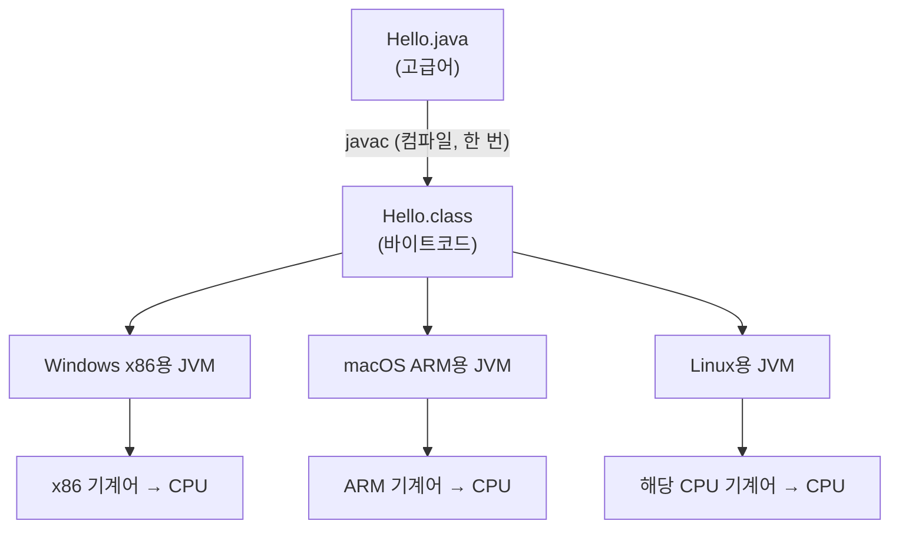
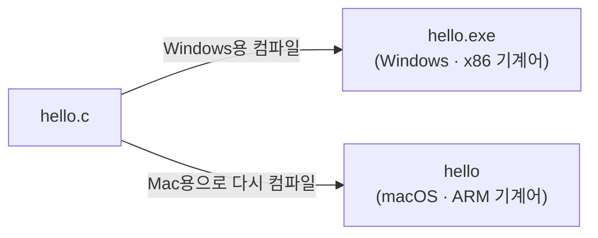

# Part1 3장 강의 노트

> 「독하게 시작하는 Java」(널널한 개발자 TV) Part1 3장. 학습자 요약·메모와 튜터 정리를 바탕으로 작성. 영상 밖 내용은 **보충**으로 표시.

---

## 3.1 고급어와 저급어 그리고 JVM ★ (25:32)
- 강의일 2026-11-23 · **영상 미시청**(주제 기준 강의) · 이해도 4(튜터)

### 핵심 개념
1. **저급어 vs 고급어**: 좋고 나쁨이 아니라 추상화 수준
   | 구분 | 예 | 특징 |
   |---|---|---|
   | 기계어 | `10110000 01100001` | CPU가 직접 실행 |
   | 어셈블리어 | `MOV AL, 61h` | 기계어와 1:1, CPU 종류에 묶임 |
   | 고급어 | `int c = a + b;` | 사람 언어에 가까움, 번역이 필요 |
2. **기계어는 CPU·OS마다 다르다**: CPU 명령어 체계(x86-64 vs ARM), 실행 파일 형식(Windows `.exe` / 리눅스 ELF / macOS Mach-O) → C/C++은 플랫폼별로 따로 컴파일
3. **Java 실행 흐름**: `.java` → javac → `.class`(바이트코드) → JVM → 그 컴퓨터의 기계어 → CPU
4. **JVM과 WORA**: JVM은 OS·CPU별로 따로 존재 → `.class`는 한 번만 만들면 됨 (비유: 바이트코드 = 국제 표준 악보, JVM = 각 나라 연주자)
5. **대가**: 중간 계층 → 시작이 느리고 메모리를 더 씀. 보완책 JIT(3.4), 대신 메모리 관리를 JVM이 해 줌(Part2 6.1)





### 예제: 바이트코드 들여다보기
```java
public class Add {
    public static void main(String[] args) {
        int a = 3; int b = 4; int c = a + b;
        System.out.println(c);
    }
}
```
```bat
javac Add.java
java Add
javap -c Add
```
```
iconst_3 / istore_1   // 3 → a
iconst_4 / istore_2   // 4 → b
iload_1 / iload_2     // a, b 불러오기
iadd                  // 정수 더하기 (1.4 연산)
istore_3              // 결과 → c
```
- `int c = a + b;` 한 줄 = 불러오기 → 연산 → 저장. `i` = int 전용 명령

### 확인 질문
- Q. Windows에서 만든 C `hello.exe`와 Java `Hello.class`를 Mac(ARM)에서 실행하면? → ✅ 정답
  - `hello.exe` ❌: Windows용 실행 파일 형식 + x86 기계어로 번역된 결과라 Mac에서 실행 불가
  - `Hello.class` ⭕: 바이트코드는 특정 CPU용이 아니고, Mac용 JVM이 그 기계에 맞는 기계어로 바꿔 실행
  - 보완: 다른 건 "파일명"이 아니라 **실행 파일 형식**. 그리고 Mac에 **JVM(JDK/JRE)이 설치되어 있어야** 한다는 전제 조건 (5.1 JDK와 JRE)
